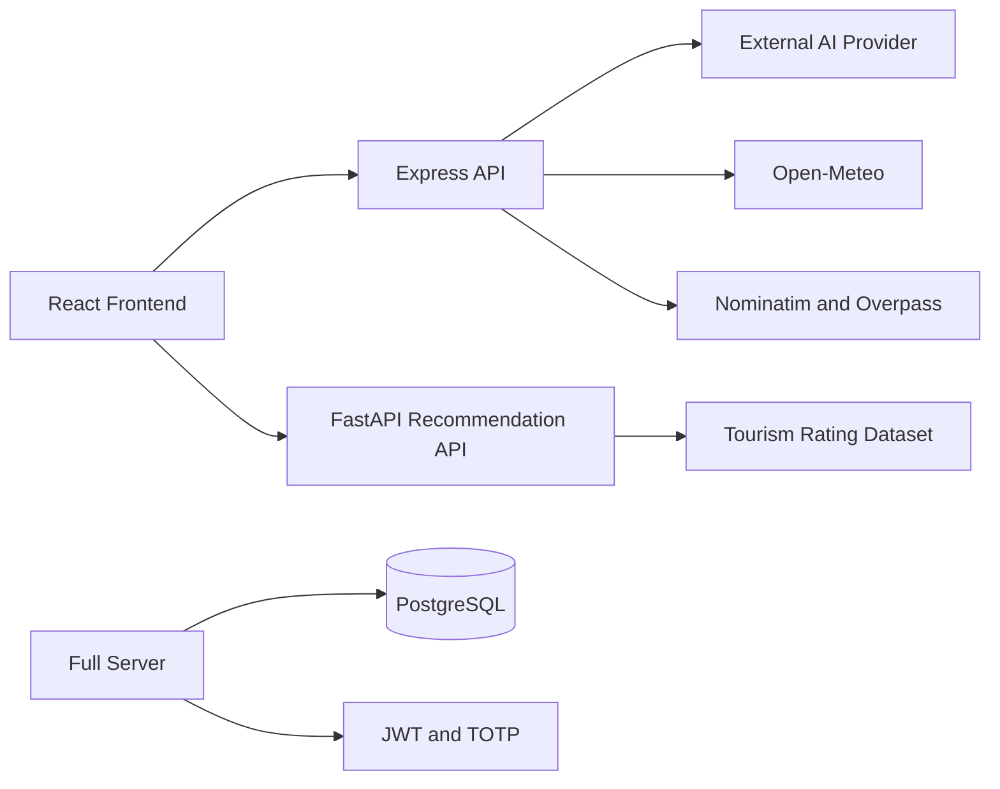

# Tourism AI Backend

Backend services for the Tourism AI application: an Express.js Node.js API for itineraries and assistant interactions, plus a FastAPI recommendation service trained with a Bogotá tourism rating dataset.

## Live Components

- [Frontend](https://github.com/AndresContreras1034/frontend-tourismAI)
- [Production frontend](https://frontend-tourism-ai.vercel.app)
- Beta backend and ML service configured for deployment through `render.yaml`

## Services

### Beta Express API

The public beta server starts with:

```powershell
npm run start:beta
```

It exposes only the public Expo itinerary, weather, and chat endpoints. It does not require PostgreSQL or mount authentication and profile routes.

Available prefix:

- `GET /` — service health
- `POST /ai/expo-plan` — generate a plan
- `POST /ai/expo-chat` — chatbot interaction
- `GET /ai/expo-weather` — tomorrow weather

### Full Express API

The complete server starts with:

```powershell
npm run dev
# or
npm start
```

It includes authentication, MFA, PostgreSQL-backed users and profiles, plans, reviews, and AI routes. Configure PostgreSQL and JWT variables before use.

### FastAPI Recommendation Service

The `ml-service` trains a `RandomForestRegressor` from the included tourism dataset when the process starts.

Endpoints:

- `GET /` — service health and dataset summary
- `GET /catalog` — available plans and travel categories
- `POST /recommendations` — ranked plan recommendations

Start it separately:

```powershell
cd ml-service
py -m pip install -r requirements.txt
py -m uvicorn app:app --host 127.0.0.1 --port 8000
```

## Architecture



## Public Beta Features

- Validated Expo plan requests
- Weather lookup with caching and retry behavior
- Local image upload limited to 5 MB
- JPEG, PNG, GIF, and WebP format validation
- Photo analysis through the configured AI provider
- In-memory rate limits
- Open-Meteo, Nominatim, and Overpass integrations
- CORS restrictions for configured frontend origins

The public beta keeps photos in memory only and does not store them on disk or in PostgreSQL.

## Technology Stack

| Technology | Role |
|---|---|
| Node.js | Express runtime |
| Express | REST API |
| Multer | In-memory photo uploads |
| PostgreSQL | Full-server data |
| JWT | Authentication |
| Speakeasy | TOTP MFA |
| Python | Recommendation runtime |
| FastAPI | ML HTTP API |
| Pandas | Dataset processing |
| Scikit-learn | Random forest model |
| Open-Meteo | Weather provider |
| OpenStreetMap | Geographic lookup |

## Project Structure

```text
src/
  beta-app.js             Public beta Express application
  beta-server.js          Beta server entry point
  app.js                  Full Express application
  server.js               Full server entry point
  modules/                Auth, users, profiles, plans, AI, and reviews
  middleware/             Shared error handling
  config/                 Environment and database configuration
ml-service/
  app.py                  FastAPI application
  engine/                 Dataset loading and ranking model
  routes/                 Recommendation endpoints
  tests/                  Recommendation engine tests
  data/                   Tourism rating dataset
render.yaml               Render beta deployment
```

## Environment Variables

`.env.example` contains the public beta variables:

```dotenv
PORT=3000
DEEPSEEK_API_KEY=
DEEPSEEK_MODEL=deepseek-flash
FRONTEND_ORIGINS=https://frontend-tourism-ai.vercel.app
```

The full server additionally requires PostgreSQL and JWT variables such as:

```dotenv
DB_HOST=
DB_PORT=5432
DB_USER=
DB_PASSWORD=
DB_NAME=
JWT_SECRET=
JWT_EXPIRES_IN=7d
```

Never commit API keys or database passwords.

## Installation

```powershell
npm install
Copy-Item .env.example .env
npm run start:beta
```

For local development:

```powershell
npm run dev
```

## ML Service

Create an isolated environment:

```powershell
cd ml-service
py -m venv .venv
.venv\Scripts\activate
py -m pip install -r requirements.txt
py -m uvicorn app:app --host 127.0.0.1 --port 8000
```

Run recommendation tests:

```powershell
cd ml-service
python -m unittest discover -s tests -p "test_*.py"
```

## Frontend Configuration

Configure the frontend with public service URLs:

```dotenv
VITE_API_URL=https://your-beta-backend.example
VITE_AI_SERVICE_URL=https://your-ml-service.example
```

Keep provider credentials in the backend environment.

## Deployment

`render.yaml` defines two free web services:

- `tourism-ai-beta-backend`
- `tourism-ai-beta-ml`

Configure `DEEPSEEK_API_KEY` as a private Render environment value. Configure the deployed frontend origins with `FRONTEND_ORIGINS`.

## Security and Data Notes

- Provider API keys must remain in backend environment variables.
- Browser variables beginning with `VITE_` are public.
- CORS must include only intended frontend origins.
- Uploaded photos are processed in memory and should not be persisted.
- Map coordinates and parking locations are approximate.
- Prices and routes are suggestions and must be verified before travel.
- Free deployments may suspend and require cold-start time.
